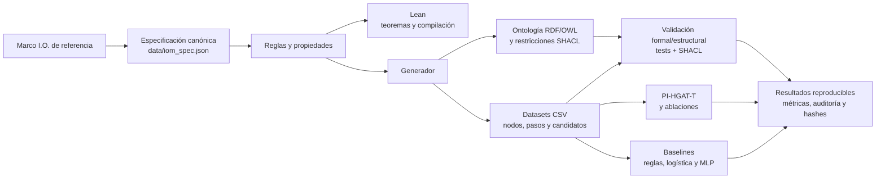

# IOM — de reglas formales a evaluación reproducible con modelos

IOM convierte un marco de cinco perspectivas —Individualidad, Dualidad, Totalidad, Evolución e Involución— en una especificación ejecutable que puede **validarse formalmente y ponerse a prueba empíricamente**. Las reglas explícitas generan relaciones y datos reproducibles; Lean, RDF/OWL y SHACL comprueban su estructura, mientras que los modelos de machine learning miden si esas relaciones pueden recuperarse sin confundir predicción con demostración. El resultado es un flujo auditable desde la especificación hasta las métricas, no una afirmación de que el modelo pruebe el marco.

**Proyecto:** [IOM en GitHub](https://github.com/luisreygarciafigueroa-creator/IOM) · [temas (topics)](https://github.com/luisreygarciafigueroa-creator/IOM)

## Empieza aquí: Dev Container

La vía recomendada es abrir el repositorio en **Visual Studio Code con la extensión Dev Containers** y elegir **Reopen in Container**. El contenedor configura Python, Lean 4.9.0 y la extensión de Lean, reduciendo diferencias entre máquinas. Una vez creado, instala las dependencias fijadas y compila:

```bash
python -m pip install -r requirements-lock.txt
lake build
```

Después elige la ruta adecuada a tu perfil. Para trabajar fuera del contenedor, consulta [Reproducción](REPRODUCCION.md) y [`.devcontainer/devcontainer.json`](.devcontainer/devcontainer.json).

> El Dev Container declara Python 3.11, mientras que la documentación de reproducción registra Python 3.12 como entorno de referencia. Para resultados comparables, usa la versión indicada en `experiments/results/software_versions.json`; si ejecutas dentro del contenedor, registra la versión efectiva con `scripts/capture_environment.py`.

## Elige tu ruta

### Perfil de lógica, especificación y verificación formal

Adecuado para modificar reglas, revisar propiedades o comprobar los artefactos derivados. La fuente canónica está en [`data/iom_spec.json`](data/iom_spec.json); valida la especificación, genera la ontología y ejecuta las pruebas:

```bash
python scripts/validate_spec.py
python scripts/generate_ontology.py
lake build
python -m unittest discover -s tests -v
python scripts/validate_shacl.py
```

Lean formaliza operadores, reglas y teoremas; RDF/OWL representa la ontología y SHACL valida restricciones. Para explorar los fundamentos: [`docs/PREMISAS_Y_TEOREMAS.md`](docs/PREMISAS_Y_TEOREMAS.md), [`docs/RELACIONES_OPERATIVAS.md`](docs/RELACIONES_OPERATIVAS.md) y el documento de referencia [`docs/MARCOI.O.txt`](docs/MARCOI.O.txt).

### Perfil de machine learning y evaluación empírica

Adecuado para reproducir el clasificador, sus ablaciones y los baselines. Ejecuta primero la ruta formal para generar/verificar los datos y luego:

```bash
python experiments/pi_hgat_t.py
python experiments/baselines.py
```

PI-HGAT-T clasifica pares dirigidos como `none`, `mirrorOf` o `creates`, usando validación cruzada leave-one-triad-out. Las etiquetas objetivo provienen de reglas RDF/SHACL explícitas: las métricas evalúan recuperación de relaciones generadas por reglas, **no validación independiente de la teoría**. El protocolo de evaluación humana independiente está separado en [`datasets/independent_eval/`](datasets/independent_eval/); la evaluación externa de reglas, en [`datasets/external_eval/`](datasets/external_eval/).

## Flujo de datos: de las reglas a los modelos



## Qué incluye

- **Cinco perspectivas:** Individualidad (`Ind`), Dualidad (`D`), Totalidad (`Tot`), Evolución (`Evol`) e Involución (`Invol`). Las tres primeras son posicionales en cada tríada; las dos últimas vectoriales.
- **Especificación:** 13 tríadas de avance y 13 de retroceso; cuatro secuencias vectoriales de cinco pasos.
- **Lean 4.9.0:** operadores temporales, espejos, reglas `creates` y teoremas; sin `sorry` ni `admit`.
- **RDF/OWL + SHACL:** axiomas, dominios/rangos y restricciones para estructura, espejo, creación y secuencias.
- **Datos:** `datasets/triad_nodes.csv` (78 filas), `datasets/vector_steps.csv` (20) y `datasets/relation_candidates.csv` (390).
- **Experimentos:** PI-HGAT-T, ablaciones, reglas deterministas, regresión logística y MLP, con particiones comparables.
- **Reproducibilidad:** pruebas, informe de auditoría, captura de entorno, manifiesto SHA-256 y empaquetado reproducible.

## Verificación integral

Con dependencias instaladas en el Dev Container, ejecuta la secuencia completa:

```bash
lake build
python scripts/validate_spec.py
python scripts/generate_ontology.py
python -m unittest discover -s tests -v
python scripts/validate_shacl.py
python experiments/pi_hgat_t.py
python experiments/baselines.py
python scripts/generate_audit_report.py
```

La CI ejecuta compilación, generación de artefactos, pruebas, validación OWL RL/SHACL, experimentos y auditoría. Para el procedimiento ampliado, dependencias y empaquetado, consulta [`REPRODUCCION.md`](REPRODUCCION.md); para la metodología y las métricas, [`EXPERIMENTOS.md`](EXPERIMENTOS.md).
