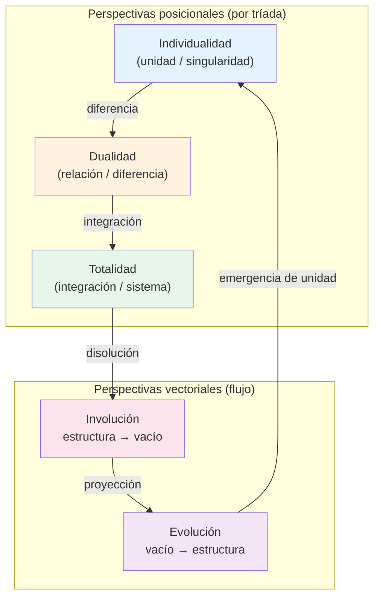

# IOM — de reglas formales a evaluación reproducible con modelos

**Resumen ejecutivo.** El marco IOM modela la **evolución y la disolución de sistemas complejos** —desde redes ecológicas y ciclos de mercado hasta transiciones cognitivas o de software— mediante cinco perspectivas interrelacionadas: Individualidad, Dualidad, Totalidad, Evolución e Involución. No es un catálogo de etiquetas: es una arquitectura formal que genera relaciones deterministas (`mirrorOf`, `creates`) a partir de 13 tríadas y cuatro secuencias vectoriales, y que puede verificarse matemáticamente (Lean) y someterse a pruebas de recuperación (modelos de machine learning).

El marco se presenta como una **arquitectura diseñada para clasificar y predecir la evolución de sistemas complejos**, demostrada formalmente en Lean 4 (teoremas sin `sorry` ni `admit`) y evaluada mediante recuperación de relaciones generadas por reglas. Las métricas de los modelos miden recuperabilidad estructural (**capa B**), no validación independiente de la teoría en el mundo exterior (**capa C**). Véase [`docs/DELIMITACION_EPISTEMOLOGICA.md`](docs/DELIMITACION_EPISTEMOLOGICA.md).

**Proyecto:** [IOM en GitHub](https://github.com/luisreygarciafigueroa-creator/IOM)

---

## Ejemplo narrativo temprano: depredador–presa

Antes de sumergirnos en la abstracción matemática, anclamos las cinco perspectivas en un caso concreto que cualquier investigador reconoce: el ciclo ecológico depredador–presa.

| Fenómeno biológico | Perspectiva IOM | Qué formaliza |
|---|---|---|
| El lobo como individuo cazador | **Individualidad** | Unidad / singularidad que actúa |
| La relación de depredación (lobo ↔ ciervo) | **Dualidad** | Diferencia / interacción entre dos unidades |
| La población o la red trófica completa | **Totalidad** | Sistema integrado |
| Recuperación tras un colapso (recolonización) | **Evolución** | Proyección del vacío hacia nueva estructura |
| Extinción local o colapso poblacional | **Involución** | Disolución de estructura hacia el vacío |

En el marco, el lobo en fase de avance puede alinearse a un nodo de Individualidad (izquierda); el ciervo, como su reflejo en fase de retroceso, a Individualidad (derecha). La depredación ocupa el centro (Dualidad) y genera una arista `creates` hacia el centro de la fase opuesta. El colapso poblacional se lee como un paso del vector Involución; la recuperación, como un paso de Evolución.

El mismo esquema se aplica a un escenario de mercado (trader ↔ activo ↔ riesgo ↔ mercado ↔ burbuja/crash). La abstracción de las cinco perspectivas deja de flotar: cada una corresponde a una lectura operativa de un sistema real.

> Plantilla lista para usar: [`datasets/ingestion/templates/biologia_depredador_presa.csv`](datasets/ingestion/templates/biologia_depredador_presa.csv). Catálogo completo de mapeos: [`docs/CATALOGO_DOMINIOS.md`](docs/CATALOGO_DOMINIOS.md).

---

## Diagrama conceptual: Individualidad ↔ Dualidad ↔ Totalidad



Cada **tríada** ocupa las tres posiciones (izquierda–centro–derecha) bajo las perspectivas Ind / D / Tot. Las dos direcciones vectoriales (Evol / Invol) atraviesan las fases de avance y retroceso. Las relaciones admisibles entre nodos son únicamente `mirrorOf` (fase opuesta + posición reflejada) y `creates` (cuatro reglas de creación lateral↔centro).

---

## Funcionalidad central: ingesta de dominios personalizados vía CSV

**Esta es una de las propuestas de valor principales del repositorio.** La ontología de 78 nodos es una **bóveda bancaria**: no se modifican nodos ni reglas core. Cualquier investigador —biólogo, economista, sociólogo, ingeniero de software— puede alinear sus conceptos a la ontología canónica sin romper las garantías formales (Lean, RDF/OWL, SHACL).

```bash
python scripts/importar_datos_personalizados.py \
    --input datasets/ingestion/templates/biologia_depredador_presa.csv \
    --output datasets/ingestion/aligned/biologia_aligned.csv
```

- **Plantillas prellenadas** en [`datasets/ingestion/templates/`](datasets/ingestion/templates/):
  - `biologia_depredador_presa.csv` — ciclo ecológico
  - `economia_transaccion_riesgo.csv` — mercado de alto riesgo
  - `plantilla_dominio.csv` — plantilla genérica
- **Catálogo de dominios** con mapeos conceptuales listos: [`docs/CATALOGO_DOMINIOS.md`](docs/CATALOGO_DOMINIOS.md)
- **Documentación de la carpeta:** [`datasets/ingestion/README.md`](datasets/ingestion/README.md)

El script valida que cada `mapped_node_id` exista entre los 78 nodos canónicos, comprueba consistencia de perspectiva/fase/posición y genera un informe JSON de alineación. Los datos alineados pueden usarse como candidatos externos en evaluación independiente o como features adicionales, **sin tocar** `data/iom_spec.json` ni la ontología core.

---

## Empieza aquí: Dev Container

La vía recomendada es abrir el repositorio en **Visual Studio Code con la extensión Dev Containers** y elegir **Reopen in Container**. El contenedor configura Python, Lean 4.9.0 y la extensión de Lean, reduciendo diferencias entre máquinas. Una vez creado, instala las dependencias fijadas y compila:

```bash
python -m pip install -r requirements-lock.txt
lake build
```

Después elige la ruta adecuada a tu perfil. Para trabajar fuera del contenedor, consulta [Reproducción](REPRODUCCION.md) y [`.devcontainer/devcontainer.json`](.devcontainer/devcontainer.json).

> El Dev Container declara Python 3.11, mientras que la documentación de reproducción registra Python 3.12 como entorno de referencia. Para resultados comparables, usa la versión indicada en `experiments/results/software_versions.json`; si ejecutas dentro del contenedor, registra la versión efectiva con `scripts/capture_environment.py`.

---

## Dos fases y tres capas epistemológicas

| | **Fase 1 — Motor de reglas formales** | **Fase 2 — Modelado predictivo** |
|---|---|---|
| **Naturaleza** | Determinista, deductiva | Inductiva sobre datos sintéticos |
| **Capa** | A (formal) + B (estructural) | B (recuperación sintética) |
| **Artefactos** | Lean, RDF/OWL, SHACL, CSV canónicos | PI-HGAT-T, baselines, métricas |
| **Pregunta** | «¿Estas relaciones son válidas según las reglas?» | «¿Un modelo puede recuperar esas relaciones?» |

La **capa C** (validación empírica real) vive en [`datasets/independent_eval/`](datasets/independent_eval/) y [`datasets/external_eval/`](datasets/external_eval/): etiquetas de anotadores humanos, **no** derivadas del generador.

### Fase 1 — Motor de reglas formales

```bash
python scripts/validate_spec.py
python scripts/sync_spec_artifacts.py --check
python scripts/generate_ontology.py
lake build
python -m unittest discover -s tests -v
python scripts/validate_shacl.py
```

### Puente metodológico y auditoría del 100 %

Las reglas formales demuestran *corrección estructural* sin ruido. El ML pregunta si esas relaciones son recuperables bajo LOO y features parciales.

**Hallazgo de la auditoría** ([`docs/AUDITORIA_METRICAS.md`](docs/AUDITORIA_METRICAS.md)): el 100 % de PI-HGAT-T y del MLP se debe a que la etiqueta es una **función determinista de (fase, posición)**, idéntica en las 13 tríadas. LOO es independiente a nivel de tríada, pero la función a aprender es compartida; el oracle de reglas también alcanza 1.0. La arquitectura GAT no es necesaria para este corpus sintético.

### Fase 2 — Modelado predictivo

```bash
python experiments/pi_hgat_t.py
python experiments/baselines.py
python scripts/audit_perfect_metrics.py
```

---

## Verificación integral (P0)

En un entorno limpio con dependencias instaladas:

```bash
lake build                          # job CI 'lean'
python scripts/verify_e2e.py        # pipeline Python completo + auditoría
```

O paso a paso (equivalente a la CI):

```bash
python scripts/validate_spec.py
python scripts/migrate_spec.py --check
python scripts/sync_spec_artifacts.py --check
python scripts/generate_ontology.py
python -m unittest discover -s tests -v
python scripts/validate_shacl.py
python experiments/pi_hgat_t.py
python experiments/baselines.py
python scripts/audit_perfect_metrics.py
python scripts/generate_audit_report.py
```

La CI ejecuta todos estos pasos. Documentación: [`REPRODUCCION.md`](REPRODUCCION.md), [`EXPERIMENTOS.md`](EXPERIMENTOS.md), [`docs/AUDITORIA_METRICAS.md`](docs/AUDITORIA_METRICAS.md).

---

## Qué incluye

- **Cinco perspectivas** posicionales y vectoriales.
- **Lean 4.9.0** sin `sorry` ni `admit`.
- **RDF/OWL + SHACL** y sincronización automática spec↔CSV↔ontología.
- **Pruebas property-based** y casos negativos (`tests/test_property_based.py`).
- **Auditoría de métricas 100 %** (`scripts/audit_perfect_metrics.py`).
- **Ingesta de dominios CSV** (funcionalidad central).
- **Protocolo de evaluación independiente** (capa C) con scoring post-hoc.
- **Reproducibilidad:** CI, hashes, manifiesto, `verify_e2e.py`.
