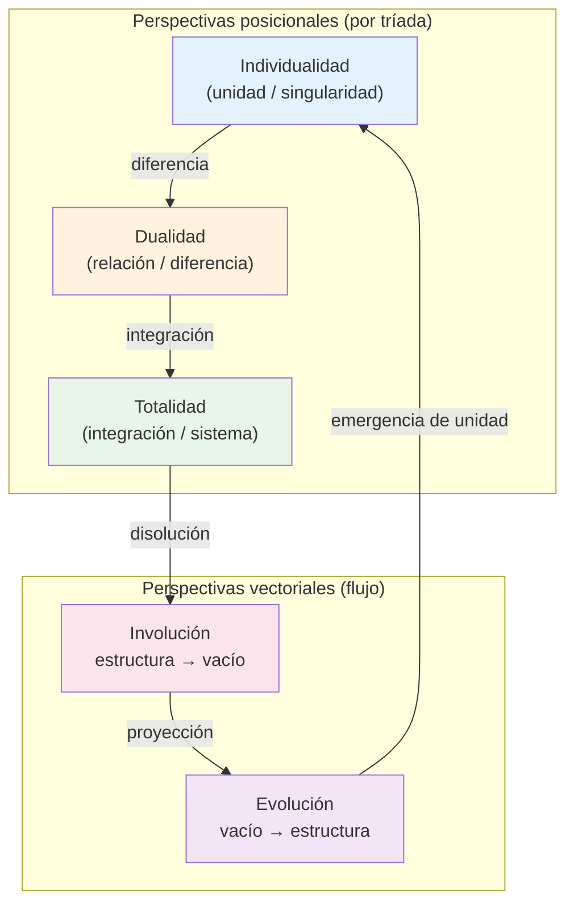
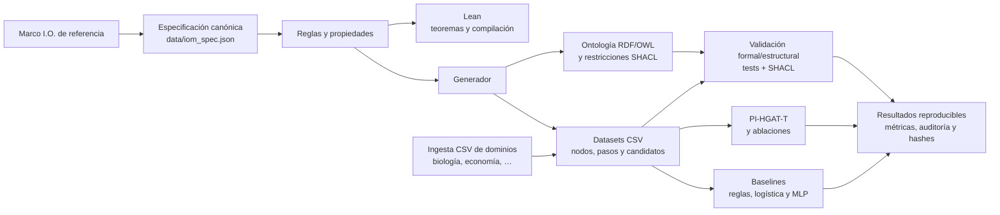

# IOM — de reglas formales a evaluación reproducible con modelos

**Resumen ejecutivo.** El marco IOM modela la **evolución y la disolución de sistemas complejos** —desde redes ecológicas y ciclos de mercado hasta transiciones cognitivas o de software— mediante cinco perspectivas interrelacionadas: Individualidad, Dualidad, Totalidad, Evolución e Involución. No es un catálogo de etiquetas: es una arquitectura formal que genera relaciones deterministas (`mirrorOf`, `creates`) a partir de 13 tríadas y cuatro secuencias vectoriales, y que puede verificarse matemáticamente (Lean) y someterse a pruebas empíricas de recuperación (modelos de machine learning).

El marco se presenta como una **arquitectura diseñada para clasificar y predecir la evolución de sistemas complejos**, demostrada formalmente en Lean 4 (teoremas sin `sorry` ni `admit`) y evaluada empíricamente mediante recuperación de relaciones generadas por reglas. Las métricas de los modelos miden recuperabilidad estructural, no validación independiente de la teoría en el mundo exterior.

**Proyecto:** [IOM en GitHub](https://github.com/luisreygarciafigueroa-creator/IOM) · [temas (topics)](https://github.com/luisreygarciafigueroa-creator/IOM)

---

## Ejemplo narrativo temprano: depredador–presa

Antes de sumergirnos en la abstracción matemática, anclamos las cinco perspectivas en un caso concreto que cualquier investigador reconoce: el ciclo ecológico depredador–presa.

| Fenómeno biológico | Perspectiva IOM | Qué formaliza |
|---|---|---|
| El lobo como individuo cazador | **Individualidad** | Unidad / singularidad que actúa |
| La relación de depredación (lobo ↔ ciervo) | **Dualidad** | Diferencia / interacción entre dos unidades |
| La población o la red trófica completa | **Totalidad** | Sistema integrado |
| Recuperación tras un colapso (recolonización) | **Evolución** | Proyección del vacío hacia nueva estructura |
| Extinción local o colapso poblacional | **Involución** | Disolución de estructura hacia el vacío |

En el marco, el lobo en fase de avance puede alinearse a un nodo de Individualidad (izquierda); el ciervo, como su reflejo en fase de retroceso, a Individualidad (derecha). La depredación ocupa el centro (Dualidad) y genera una arista `creates` hacia el centro de la fase opuesta. El colapso poblacional se lee como un paso del vector Involución; la recuperación, como un paso de Evolución.

El mismo esquema se aplica a un escenario de mercado (trader ↔ activo ↔ riesgo ↔ mercado ↔ burbuja/crash). La abstracción de las cinco perspectivas deja de flotar: cada una corresponde a una lectura operativa de un sistema real.

> Plantilla lista para usar: [`datasets/ingestion/templates/biologia_depredador_presa.csv`](datasets/ingestion/templates/biologia_depredador_presa.csv). Catálogo completo de mapeos: [`docs/CATALOGO_DOMINIOS.md`](docs/CATALOGO_DOMINIOS.md).

---

## Diagrama conceptual: Individualidad ↔ Dualidad ↔ Totalidad



Cada **tríada** ocupa las tres posiciones (izquierda–centro–derecha) bajo las perspectivas Ind / D / Tot. Las dos direcciones vectoriales (Evol / Invol) atraviesan las fases de avance y retroceso. Las relaciones admisibles entre nodos son únicamente `mirrorOf` (fase opuesta + posición reflejada) y `creates` (cuatro reglas de creación lateral↔centro).

---

## Funcionalidad central: ingesta de dominios personalizados vía CSV

**Esta es una de las propuestas de valor principales del repositorio.** La ontología de 78 nodos es una **bóveda bancaria**: no se modifican nodos ni reglas core. Cualquier investigador —biólogo, economista, sociólogo, ingeniero de software— puede alinear sus conceptos a la ontología canónica sin romper las garantías formales (Lean, RDF/OWL, SHACL).

```bash
python scripts/importar_datos_personalizados.py \
    --input datasets/ingestion/templates/biologia_depredador_presa.csv \
    --output datasets/ingestion/aligned/biologia_aligned.csv
```

- **Plantillas prellenadas** en [`datasets/ingestion/templates/`](datasets/ingestion/templates/):
  - `biologia_depredador_presa.csv` — ciclo ecológico
  - `economia_transaccion_riesgo.csv` — mercado de alto riesgo
  - `plantilla_dominio.csv` — plantilla genérica
- **Catálogo de dominios** con mapeos conceptuales listos: [`docs/CATALOGO_DOMINIOS.md`](docs/CATALOGO_DOMINIOS.md)
- **Documentación de la carpeta:** [`datasets/ingestion/README.md`](datasets/ingestion/README.md)

El script valida que cada `mapped_node_id` exista entre los 78 nodos canónicos, comprueba consistencia de perspectiva/fase/posición y genera un informe JSON de alineación. Los datos alineados pueden usarse como candidatos externos en evaluación independiente o como features adicionales, **sin tocar** `data/iom_spec.json` ni la ontología core.

---

## Empieza aquí: Dev Container

La vía recomendada es abrir el repositorio en **Visual Studio Code con la extensión Dev Containers** y elegir **Reopen in Container**. El contenedor configura Python, Lean 4.9.0 y la extensión de Lean, reduciendo diferencias entre máquinas. Una vez creado, instala las dependencias fijadas y compila:

```bash
python -m pip install -r requirements-lock.txt
lake build
```

Después elige la ruta adecuada a tu perfil. Para trabajar fuera del contenedor, consulta [Reproducción](REPRODUCCION.md) y [`.devcontainer/devcontainer.json`](.devcontainer/devcontainer.json).

> El Dev Container declara Python 3.11, mientras que la documentación de reproducción registra Python 3.12 como entorno de referencia. Para resultados comparables, usa la versión indicada en `experiments/results/software_versions.json`; si ejecutas dentro del contenedor, registra la versión efectiva con `scripts/capture_environment.py`.

---

## Dos fases claramente separadas

El repositorio se organiza en **dos bloques lógicos** que no deben confundirse:

| | **Fase 1 — Motor de reglas formales** | **Fase 2 — Modelado predictivo** |
|---|---|---|
| **Naturaleza** | Determinista, deductiva | Empírica, inductiva |
| **Artefactos** | Lean, RDF/OWL, SHACL, CSV canónicos | PI-HGAT-T, baselines, métricas |
| **Pregunta que responde** | «¿Estas relaciones son estructuralmente válidas según las reglas?» | «¿Un modelo puede recuperar esas relaciones a partir de los datos generados?» |
| **Scripts principales** | `validate_spec.py`, `generate_ontology.py`, `validate_shacl.py`, `lake build` | `experiments/pi_hgat_t.py`, `experiments/baselines.py` |

### Fase 1 — Motor de reglas formales

Adecuado para modificar reglas, revisar propiedades o comprobar los artefactos derivados. La fuente canónica está en [`data/iom_spec.json`](data/iom_spec.json):

```bash
python scripts/validate_spec.py
python scripts/generate_ontology.py
lake build
python -m unittest discover -s tests -v
python scripts/validate_shacl.py
```

Lean formaliza operadores, reglas y teoremas; RDF/OWL representa la ontología y SHACL valida restricciones. Para explorar los fundamentos: [`docs/PREMISAS_Y_TEOREMAS.md`](docs/PREMISAS_Y_TEOREMAS.md), [`docs/RELACIONES_OPERATIVAS.md`](docs/RELACIONES_OPERATIVAS.md) y el documento de referencia [`docs/MARCOI.O.txt`](docs/MARCOI.O.txt).

### Puente metodológico: de lo determinista a lo probabilístico

Una vez que la **Fase 1 garantiza la estructura absoluta de las relaciones** (teoremas Lean + restricciones SHACL + datasets regenerados de forma determinista), la **Fase 2 toma ese universo puramente matemático** y lo somete a aprendizaje automático.

**¿Por qué es útil la validación empírica mediante ML?**  
Las reglas formales demuestran *corrección estructural* en un mundo sin ruido. El aprendizaje automático responde a una pregunta distinta y complementaria: **¿esas mismas relaciones siguen siendo recuperables cuando el modelo solo ve atributos parciales, particiones leave-one-triad-out y, en extensiones futuras, datos alineados de dominios externos con su ruido inherente?**  

- Las ablaciones (sin fase / sin posición) cuantifican la contribución de cada factor estructural y revelan puntos de fragilidad.  
- La recuperación perfecta bajo leave-one-triad-out demuestra que la ontología es *aprendible* a partir de rasgos mínimos, no un artefacto ad hoc.  
- El puente entre fases es explícito: Fase 1 produce el gold determinista; Fase 2 mide si un modelo inductivo reconstruye ese gold bajo condiciones de generalización.  
- Cuando se incorporan CSV de dominios personalizados (biología, economía, etc.), el mismo pipeline permite evaluar robustez frente a perturbaciones del mundo real sin alterar la bóveda formal.

Las métricas **no demuestran el marco en el mundo exterior**; demuestran que las relaciones generadas por reglas son recuperables por aprendizaje automático y, por tanto, que la ontología ofrece una base estable sobre la cual construir evaluaciones empíricas posteriores.

### Fase 2 — Modelado predictivo y aprendizaje automático

Adecuado para reproducir el clasificador, sus ablaciones y los baselines. Ejecuta primero la Fase 1 y luego:

```bash
python experiments/pi_hgat_t.py
python experiments/baselines.py
```

PI-HGAT-T clasifica pares dirigidos como `none`, `mirrorOf` o `creates`, usando validación cruzada leave-one-triad-out. Las etiquetas objetivo provienen de reglas RDF/SHACL explícitas: las métricas evalúan recuperación de relaciones generadas por reglas, **no validación independiente de la teoría**. El protocolo de evaluación humana independiente está separado en [`datasets/independent_eval/`](datasets/independent_eval/); la evaluación externa de reglas, en [`datasets/external_eval/`](datasets/external_eval/).

---

## Flujo de datos: de las reglas a los modelos



---

## Qué incluye

- **Cinco perspectivas:** Individualidad (`Ind`), Dualidad (`D`), Totalidad (`Tot`), Evolución (`Evol`) e Involución (`Invol`). Las tres primeras son posicionales en cada tríada; las dos últimas vectoriales.
- **Especificación:** 13 tríadas de avance y 13 de retroceso; cuatro secuencias vectoriales de cinco pasos.
- **Lean 4.9.0:** operadores temporales, espejos, reglas `creates` y teoremas; sin `sorry` ni `admit`.
- **RDF/OWL + SHACL:** axiomas, dominios/rangos y restricciones para estructura, espejo, creación y secuencias.
- **Datos:** `datasets/triad_nodes.csv` (78 filas), `datasets/vector_steps.csv` (20) y `datasets/relation_candidates.csv` (390).
- **Experimentos:** PI-HGAT-T, ablaciones, reglas deterministas, regresión logística y MLP, con particiones comparables.
- **Ingesta de dominios (funcionalidad central):** plantillas CSV, script de alineación y catálogo interdisciplinario para conectar biólogos, economistas y otras profesiones sin modificar el core.
- **Reproducibilidad:** pruebas, informe de auditoría, captura de entorno, manifiesto SHA-256 y empaquetado reproducible.

---

## Verificación integral

Con dependencias instaladas en el Dev Container, ejecuta la secuencia completa:

```bash
lake build
python scripts/validate_spec.py
python scripts/generate_ontology.py
python -m unittest discover -s tests -v
python scripts/validate_shacl.py
python experiments/pi_hgat_t.py
python experiments/baselines.py
python scripts/generate_audit_report.py
```

La CI ejecuta compilación, generación de artefactos, pruebas, validación OWL RL/SHACL, experimentos y auditoría. Para el procedimiento ampliado, dependencias y empaquetado, consulta [`REPRODUCCION.md`](REPRODUCCION.md); para la metodología y las métricas, [`EXPERIMENTOS.md`](EXPERIMENTOS.md).
