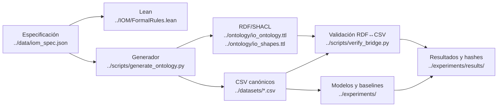

# Mapa verificable del pipeline

Rutas fuente: [especificación](https://github.com/luisreygarciafigueroa-creator/IOM/blob/main/data/iom_spec.json), [reglas Lean](https://github.com/luisreygarciafigueroa-creator/IOM/blob/main/IOM/FormalRules.lean), [generador](https://github.com/luisreygarciafigueroa-creator/IOM/blob/main/scripts/generate_ontology.py), [ontología](https://github.com/luisreygarciafigueroa-creator/IOM/blob/main/ontology/io_ontology.ttl), [candidatos](https://github.com/luisreygarciafigueroa-creator/IOM/blob/main/datasets/relation_candidates.csv), [PI-HGAT-T](https://github.com/luisreygarciafigueroa-creator/IOM/blob/main/experiments/pi_hgat_t.py), [baselines](https://github.com/luisreygarciafigueroa-creator/IOM/blob/main/experiments/baselines.py).

Orden de ejecución: generar artefactos → validar contratos CSV → cotejar RDF y etiquetas → ejecutar pruebas/SHACL → modelos → publicar resultados.
